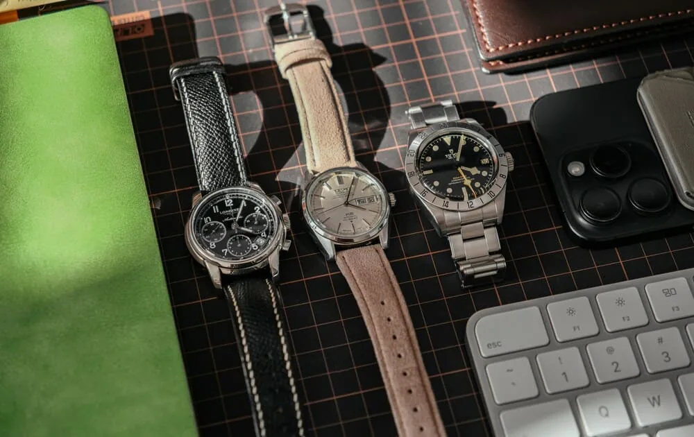
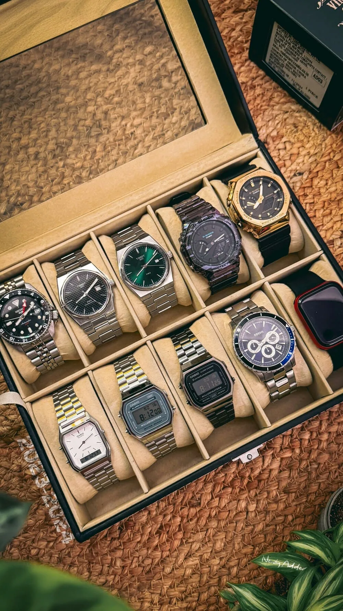

Collections rarely start with a plan. You buy a first watch, then a second because it looked great, then a third because it was on sale. A few years later you own five black divers on steel bracelets and nothing to wear with a suit. Thinking in roles helps you avoid that trap: before asking "which watch?", ask "what for?".

## Think in roles, not models

The idea is simple: every watch in your collection should have a job in your life. The most common roles are:

- **The daily wearer.** The one you put on without thinking, at the office or at the weekend. Versatile, legible, reasonably tough, sensibly sized.
- **The dress watch.** Thin, discreet, often on a leather strap, slipping under a shirt cuff. For weddings, interviews and dinners.
- **The sports or tool watch.** Diver, chronograph, GMT, pilot's watch: a watch built for a specific function and to take a few more knocks.
- **The beater.** The one you wear in the garden, hiking or doing DIY without a second thought. Often quartz or an affordable model.

Some collectors add more personal roles on top: a travel watch with a second time zone, a family heirloom, the special piece that only comes out on Sundays.

## The three-watch collection

It's the formula most often recommended for getting started, and for many collectors it's enough for life:

1. **A daily wearer** on a steel bracelet, with a clean dial and at least 100 m of water resistance.
2. **A dress watch** on leather, thinner, without unnecessary complications.
3. **A watch with character**: a chronograph, a diver or a GMT, depending on your taste and activities.

Three well-chosen watches cover almost every situation. And each one gets enough wrist time that you actually wear it, which stops being true past a certain collection size.

A popular variation swaps the dress watch for a beater, for people who never wear a suit. The rule stays the same: each watch should cover a situation the others handle badly.

## Avoid duplicates

A duplicate is the watch you buy because you like it, but which does exactly the same job as one already in your box. A few questions to ask before buying:

- **In what situation will I wear it** instead of a watch I already own?
- **Is it a different style**, or just a different dial colour?
- **Is it the same size**, the same bracelet, the same function?
- **Which one would I sell** if I could only keep one of the two?

If you can't clearly answer the first question, it's probably a duplicate. That's not forbidden: some collectors happily own nothing but divers, and that's a coherent collection too. What matters is that it's a choice rather than an accident.

## Budget tiers

A coherent collection can be built at any price level. What changes is how you spread the budget.

- **Starting out, a few hundred euros per watch.** Entry-level Japanese and Swiss brands, as well as microbrands, offer very solid automatic and quartz watches. It's the ideal way to find out what you really like: size, style, strap.
- **The middle tier, roughly one to a few thousand euros.** Better finishing, in-house or certified movements, and stronger value retention on some models.
- **High-end.** Here every purchase is a commitment. It's best to have already learned, with more affordable watches, what you actually wear.

One effective approach: spend more on the watch you'll wear most often, and stay sensible on the ones that rarely come out. A dress watch worn four times a year doesn't need the same budget as your daily wearer.

Remember the hidden costs too: servicing a mechanical watch, insurance above a certain value, spare straps.

## Look at what you really wear

This is the most useful advice and the least followed. We think we know which watches we wear, but memory plays tricks. The latest purchase feels like it's on your wrist all the time; the one sleeping at the back of the box for eight months is forgotten.

For a few months, note down the watch you wear every day. The results are often surprising:

- one watch worn most of the time, which may deserve a more accomplished version;
- two or three watches that almost never come out, whose sale could fund a more considered purchase;
- a role you thought was important but which doesn't match your actual life.

That data is worth more than any list of "must-have watches". It tells you what to buy, and above all what to sell.

## Sell to collect better

A coherent collection isn't frozen. Selling a watch you don't wear isn't a failure: it's the healthiest way to let your collection evolve without growing endlessly. Many collectors adopt a "one in, one out" rule once they reach the number of watches that suits them.

## Your watches in Arcora

In Arcora, Wrist Check lets you log the watch you're wearing each day, with streaks that reward consistency. After a few weeks you can clearly see which watches live on your wrist and which ones sleep. And if one of them no longer has a place, you can list it on the Market, between members and with no commission.

## In short

- Think in roles: daily, dress, sports or tool, beater.
- Three well-chosen watches cover almost every situation.
- Before buying, ask in which situation the new watch will replace the others.
- Put the budget into the watch you wear most.
- Track what you really wear, then sell what never comes out.
