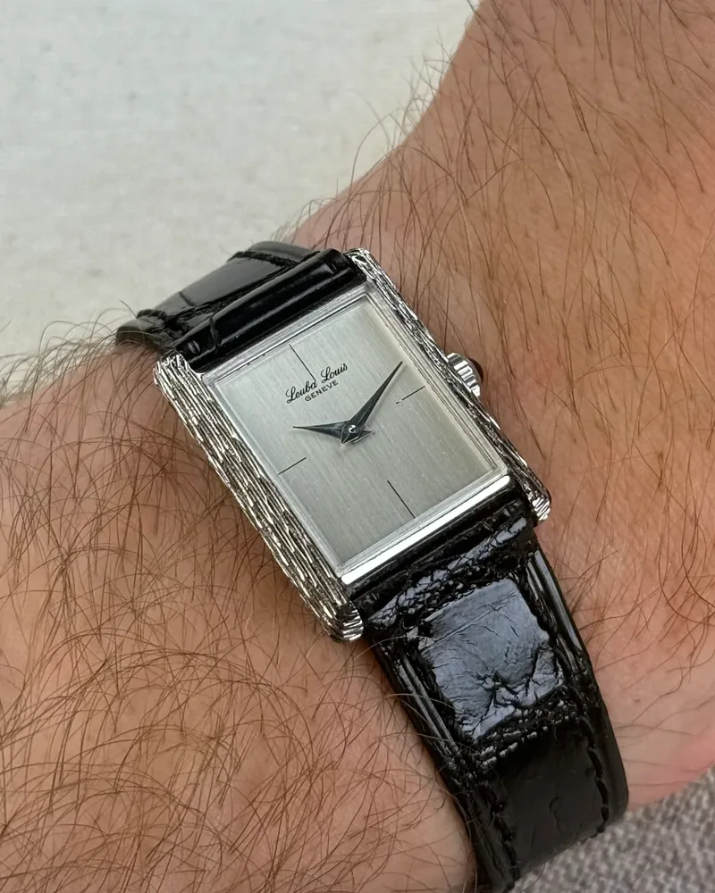

A great wrist shot doesn't need an expensive camera or a studio. Your phone is more than enough, as long as you take care of four things: light, angle, a clean watch and a few simple settings.

## 1. Light: soft and indirect

This matters more than anything else. A watch crystal reflects everything, and a polished dial can turn into a white blob in direct sun.

- **Stand near a window**, without the sun hitting the watch directly. An overcast day is ideal: the light is soft and even.
- **Skip the flash** and overhead lights, which create harsh reflections and off colours.
- **Outdoors, find some shade** or shoot late in the day, when the light is warmer and lower.
- **Tilt your wrist slightly** until the reflection leaves the crystal. A few degrees is enough.

## 2. Angle and lens: avoid distortion

Phones default to a wide-angle lens, which enlarges whatever is close and shrinks the rest. The result: the watch looks bigger than it is, and the bracelet bends.

- **Use the 2× or 3× lens** if your phone has one, and step back a little.
- **Otherwise, step back and crop** afterwards rather than pushing the phone right up to the watch.
- **Hold the phone parallel to the dial**, or slightly above it. A steep side angle squashes the proportions.

It's also about honesty: on the Arcora gallery, other collectors look at your photo to judge how a watch will wear on their wrist. A distortion-free shot genuinely helps them.

## 3. A clean watch

Every detail shows in a sharp photo.

- **Wipe the crystal** with a microfibre cloth: fingerprints and dust stand out a lot.
- **Clean a steel bracelet** if needed, especially between the links.
- **Set the time** so the logo and sub-dials stay clear. The classic 10:10 works for exactly that reason.

## 4. Pose and background

- **Keep your wrist relaxed**, hand slightly loose. A tense wrist shows tendons and rotates the watch.
- **Pick a simple background**: a sleeve, denim, a wooden table. The eye should go to the watch.
- **Leave some space** around your wrist so you can crop.

## 5. Phone settings

- **Tap the dial on screen** to focus on it.
- **Lower the exposure a little** (slide your finger down on most phones): a slightly dark image beats a blown-out dial.
- **Turn off portrait mode** for close-ups: the artificial blur often cuts badly around the lugs and strap.
- **Take several shots**, varying the angle slightly, and keep the best one.

## 6. Editing: keep it light

A small tweak to brightness, contrast and framing is plenty. Avoid filters that shift colours: a blue dial should stay the same blue, especially if the photo helps someone choose.

## Share it on the gallery

Once you have a shot you like, add it to your watch in Arcora and post it to the wrist gallery with your wrist size. Other members can filter by wrist size and say whether the watch looks small, perfect or large on you: the best way to help someone who's on the fence.

## In short

1. Soft, indirect daylight, no flash.
2. 2× lens or step back, phone parallel to the dial.
3. Clean crystal and bracelet, well-chosen time.
4. Focus on the dial, exposure slightly down.
5. Light editing, true colours.
