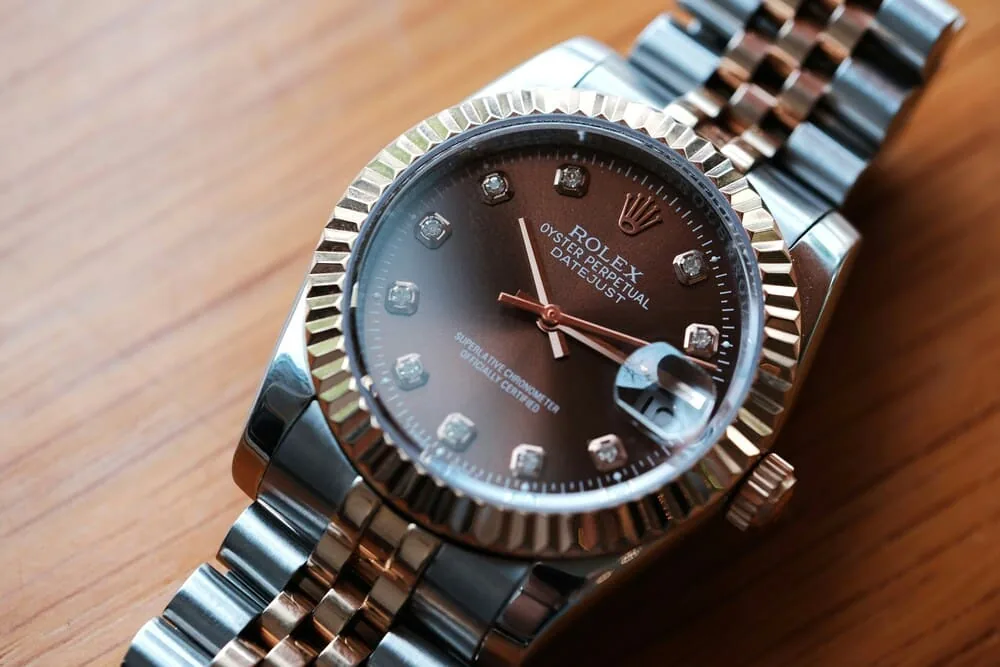
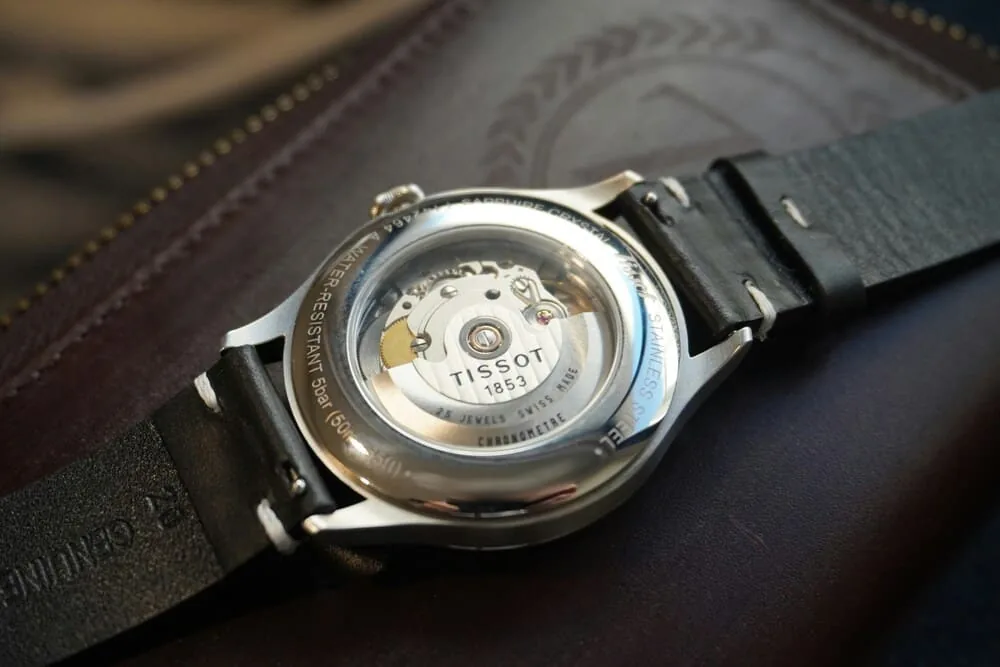

Buying a pre-owned watch from a private seller is often the best way to find the piece you want at a fair price. It's also where counterfeits circulate, some of them very convincing. The good news: most scams can be spotted before you even see the watch, as long as you take the time to check. Here's a four-step method, from the listing to the handover.

## Red flags in the listing

Before you look at the dial, look at the context. The same warning signs come up again and again:

- **A price well below the market.** A sought-after watch doesn't sell for 40% less than everywhere else without a reason. Compare several listings of the same model, in the same condition and with the same level of papers.
- **Photos that aren't the seller's own.** Images that are too perfect, white catalogue backgrounds, or pictures that turn up elsewhere with a reverse image search.
- **A vague backstory.** "Gift, never worn", "inherited it, don't know much about watches": not a problem in itself, but it shouldn't replace precise answers.
- **Urgency.** "Several buyers interested", "I'm leaving tomorrow": pressure is there to stop you checking.
- **Refusing to meet**, or insisting on remote payment by instant bank transfer or another method that's hard to dispute.

A single one of these proves nothing. Two or three together should make you slow down considerably.

## Ask for the right photos

An honest seller has no trouble taking a few extra pictures. Ask for:

1. **The watch next to a note** with your first name and today's date. It's simple proof that they actually have it in hand.
2. **A sharp close-up of the dial**, without glare. Printing should be crisp, even and perfectly aligned. Look at the indices, the hands and the date magnifier if the model has one.
3. **The caseback and case sides**, for engravings and overall condition.
4. **The clasp and links**, often less carefully finished on copies.
5. **A short video** of the seconds hand and of setting the time.

Then compare with the brand's official photos **for the same reference**, or with examples sold by reputable dealers. The differences are often in the details: a typeface slightly too bold, a dial colour that never existed for that reference, a date that sits off-centre in its window, a bezel that doesn't match the model.

Keep one important limit in mind: the best copies today are hard to tell apart from photos, even for a trained eye. Photos are mainly there to weed out bad listings, not to give a watch a final seal of approval.

## Check that everything adds up: reference, serial, papers

A genuine watch tells a consistent story. A counterfeit often gives itself away through a mismatch between its parts.

- **The reference** (the model number) should match exactly what you see: size, material, dial, bezel, bracelet. A reference that never existed with that dial is a strong warning sign.
- **The serial number** should be consistent with the stated era and identical on the watch and the warranty card. Ask for it privately rather than in a public listing, and never publish your own: it can be used to fake papers.
- **Papers** aren't absolute proof. They get forged too, and genuine papers can travel with a fake watch. Check that the retailer's name, the date and the reference are plausible. An invoice from an authorised dealer or from the brand's service centre is a plus.
- **The caseback.** If the model normally has a solid caseback and the listing shows a display back, or vice versa, ask why.

## The calibre has the final word

The inside is where the difference is hardest to hide. Every model uses a specific calibre documented by the brand. A counterfeit almost always uses a different movement, even when the outside is very close.

A few pointers:

- **Look up the reference's calibre** before you see the watch: its general layout, the rotor, the engravings, the functions.
- **The seconds hand isn't enough.** A hand that jumps once a second means quartz, which rules out a watch sold as mechanical. But many copies are automatic, so a smooth sweep proves nothing.
- **Every function should work as intended**: quick-set date, independent GMT hand, a chronograph that starts, stops and resets cleanly.

On a watch with a solid caseback, only a watchmaker can open the case and check the calibre. It's the most reliable check available to a private buyer.

## Meet at a watchmaker

For any significant purchase, suggest completing the sale **at an independent watchmaker or a dealer** willing to examine the watch. Expect to pay a small fee for their time; it's usually money well spent. They can open the caseback, identify the calibre, check overall condition and sometimes measure accuracy.

An honest seller will generally agree, perhaps splitting the cost. A flat refusal is an answer in itself.

Some brands also offer checks through their service centres, with varying lead times and costs. It takes longer, but it's the most authoritative opinion.

## Questions to ask the seller

Ask them in writing before you meet, and keep the conversation:

- How long have you owned the watch, and where was it bought?
- Has it been serviced? By whom, and do you have the invoice?
- What calibre does it use?
- Which parts have been replaced (dial, hands, crystal, bracelet)?
- What exactly comes with it: box, warranty card, receipt, links?
- Are you happy for a watchmaker to check it before payment?

The answers matter, but how precise they are matters even more. Someone who knows their watch answers quickly and directly.

## Paying and closing the deal safely

- **Never pay before seeing the watch**, especially with an irreversible method.
- **Hand over in person**, in a public place or at the watchmaker's.
- **Write a simple receipt**: date, reference, serial number, price, names and signatures of both parties.
- **Be wary of last-minute banker's drafts or cheques**, especially late on a weekend: confirm them with the issuing bank before handing anything over.

## Buying on Arcora

On Arcora's Market, sales happen between members with no commission, and you talk to the seller through the in-app messaging, so you keep a written record of every question and answer. Each listing is linked to a watch page where the seller can fill in the reference, the calibre and what they have in terms of box and papers. That makes comparisons easier, but it doesn't replace a watchmaker's eye: for an important piece, keep the habit of meeting at a workshop.

## In short

- A price that's too low, borrowed photos and urgency should make you slow down.
- Ask for dated, sharp photos of the dial, caseback and clasp.
- Check that reference, serial number, papers and calibre all match.
- Papers don't prove everything: only a watchmaker can confirm the movement.
- No remote payment before you've seen the watch.
