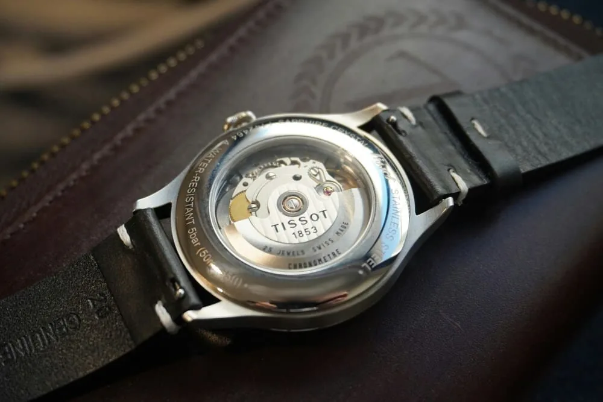
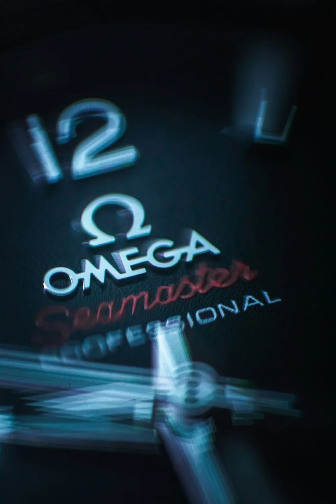

Your automatic watch has gained a few seconds this week. Is that normal? Should you worry? A mechanical watch will never be as accurate as a quartz, and that's entirely expected. But there's a difference between normal drift and a sign that a service is due, and it's worth knowing how to tell them apart.

## What "seconds per day" means

A mechanical watch's accuracy is expressed in **seconds per day** (s/d). A watch running at +5 s/d gains five seconds in 24 hours; one at −3 s/d loses three.

This daily deviation is also called the **rate**. It's never perfectly stable: it varies with how you wear the watch, how it rests overnight, the temperature and how wound the mainspring is. That's why standards talk about an **average daily rate**, measured over several days and in several conditions.

For a sense of scale: a watch that drifts 10 s/d builds up roughly a minute of error per week. For many owners that's perfectly acceptable, as long as they reset the time now and then.

## Typical tolerances

There's no single "normal" accuracy: it all depends on the calibre and how finely it's regulated.

- **Entry-level movements** are often specified by their makers with fairly wide tolerances. Seiko, for example, lists −35 to +45 s/d for its 4R automatic calibres. In practice many examples do much better, but that range is all the brand guarantees.
- **Mid-range movements** are regulated more finely, with tighter stated tolerances.
- **Certified chronometers** meet a specific standard, described below.

The right reflex: look up the official specification for your watch's calibre. That's what tells you whether your watch is within spec.

## Chronometers, COSC and brand certifications

"**Chronometer**" isn't just a marketing word. In Switzerland it refers to a watch whose movement has passed testing by the **COSC** (the official Swiss chronometer testing institute). The movement is tested over several days, in different positions and at three temperatures. For a typical-size mechanical movement, the required average daily rate is between **−4 and +6 s/d**, along with other criteria on consistency.

Some brands go further with their own certifications, often after casing, meaning the complete watch rather than the bare movement. Rolex, for example, states −2/+2 s/d for its "Superlative Chronometer" watches. Omega has some of its "Master Chronometer" watches certified by the Swiss Federal Institute of Metrology (METAS), with tests that include resistance to magnetism.

Bear in mind that these tolerances apply under test conditions. On the wrist, the same watch's rate can vary a little without that indicating a fault.

## What affects accuracy

**Position.** The regulating organ, the balance and hairspring, doesn't behave in exactly the same way when the watch is flat, crown down or crown up. That's why the rate differs between wearing and resting. A trick collectors know well: if your watch runs a little fast, try resting it overnight in a position where it loses time, dial up or crown down for example. Test over a few nights to find the right one.

**Temperature.** Cold and heat slightly change the properties of the hairspring and the oils. Modern alloys greatly reduce the effect, but a watch left in a car in high summer or on a windowsill in winter may drift differently.

**Power reserve.** A well-wound mainspring delivers more consistent force than a nearly empty one. An automatic that isn't worn much, or a hand-wound watch near the end of its reserve, can see its rate change. A watch worn regularly, or wound every morning, behaves more consistently.

**Magnetism.** This is the most common cause of sudden, large drift. Speakers, magnetic bag clasps, phone cases, laptops, tablets: magnets are everywhere. A magnetised hairspring sticks to itself and the watch often starts running very fast, sometimes by several minutes a day. The good news: a watchmaker can demagnetise it in seconds, usually for a small fee.

**Shocks.** A drop or a hard knock can upset the regulation or even damage a pivot. If the rate changes abruptly after an impact, have it checked.

## How to measure your watch's accuracy

**The simple method: compare with a reference time.** No equipment needed.

1. Open a reliable time source synchronised with an atomic clock: a dedicated website, or your smartphone's clock, which sets itself from the network.
2. Set your watch to the exact time, stopping the seconds hand if your calibre allows it.
3. Every day, at roughly the same time, note the difference in seconds.
4. Keep going for at least five to seven days, wearing the watch normally.
5. Divide the total difference by the number of days: that's your average rate.

A measurement over a single day doesn't mean much. The weekly average is what reflects your real-life use.

**The instant method: the timegrapher.** Watchmakers use a device called a timegrapher, which listens to the watch's ticking and shows within seconds the rate, the balance amplitude and the beat error (the asymmetry between the two halves of each oscillation). There are smartphone apps that take a similar measurement using the phone's microphone. They're less precise than a workshop instrument and sensitive to background noise, but they give a good indication and let you compare positions.

## When should you worry?

A watch that stays stable within its tolerance, even a wide one, is fine. What should alert you is **change**:

- the rate gets clearly worse compared with your previous measurements;
- the watch suddenly starts running very fast (think magnetism first);
- the power reserve drops at the same time;
- the rate becomes very erratic from one day to the next.

In these cases, demagnetising or regulating may be enough. But if the watch hasn't been serviced for a long time, it's often a sign that the oils are ageing and a full service is due. That's where a history of your measurements becomes valuable: it shows whether the drift is new or gradual.

## Track your measurements in Arcora

In Arcora you can log accuracy measurements on each watch's page and follow how they evolve over time, alongside its service history. A timegrapher-style measuring feature is being added to take this further. The day your watch starts drifting, you'll know straight away whether it's new.

## In short

- Accuracy is measured in seconds per day, averaged over several days.
- A COSC chronometer must hold an average rate of −4 to +6 s/d in testing.
- Position, temperature, power reserve and magnetism all affect the rate.
- Measure over a week by comparing with a reference time.
- What matters is the trend: new drift deserves a visit to the watchmaker.
