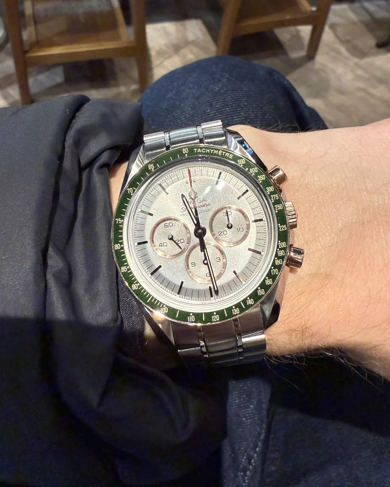

A watch can look stunning in photos and wrong the moment it's on your wrist. Too big and it overhangs and slides around; too small and it disappears. The good news: the right size isn't guesswork. You can measure it. Here's the method, the reference points and the traps to avoid.

## Start by measuring your wrist

Two measurements matter, and most people forget the second one.

**Wrist circumference.** Wrap a soft tape measure just above your wrist bone, where you wear your watch. No tape? A strip of paper marked with a pen, then laid against a ruler, works just as well.

**The width of the top of your wrist.** Lay a ruler across your wrist and measure the flat part from edge to edge. That's the surface the watch actually sits on, and it decides whether a watch fits or overhangs.

## The number that really matters: lug-to-lug

Everyone looks at case diameter. But it's the **lug-to-lug** distance, from the tip of one lug to the tip of the other, that makes or breaks the fit.

The rule is simple: **lug-to-lug should not exceed the width of the top of your wrist.** If the lugs hang over the edge, the strap floats in mid-air and the watch looks too big, whatever its diameter.

That's why a 40 mm watch with short lugs can wear better than a 38 mm watch with long ones. Good spec sheets list lug-to-lug; if not, forums and review videos usually mention it.

## Sizing chart by wrist circumference

These ranges are starting points for a classic watch (round case, thin bezel). They don't replace trying one on.

| Wrist circumference | Suggested diameter | Suggested lug-to-lug |
|---|---|---|
| Under 6 in (15 cm) | 34–37 mm | up to 42 mm |
| 6–6.5 in (15–16.5 cm) | 36–39 mm | up to 46 mm |
| 6.5–7 in (16.5–18 cm) | 38–42 mm | up to 49 mm |
| 7–7.7 in (18–19.5 cm) | 40–44 mm | up to 52 mm |
| Over 7.7 in (19.5 cm) | 42 mm and up | over 52 mm |

## What changes how big a watch looks

Two watches with the same diameter can wear very differently. A few things matter a lot:

- **The bezel.** A dive or tachymeter bezel shrinks the dial, so the watch looks smaller. A thin bezel gives all the space to the dial, so it looks bigger.
- **Dial colour.** Light dials (white, silver, cream) look larger; black or navy dials look tighter.
- **Thickness.** Above roughly 13–14 mm, a watch catches on cuffs and looks chunky even at a sensible diameter.
- **Case shape.** A cushion or square case takes up more room than a round case of the same diameter.
- **Strap or bracelet.** A steel bracelet adds visual weight; a slim leather strap or a NATO lightens the whole thing.

## Trends and personal taste

Watches grew through the 2000s, then came back to more restrained sizes: many recent releases sit between 36 and 40 mm. You don't have to follow the trend. Some people want a watch that gets noticed, others one that slips under a cuff. The guidelines above are there to avoid an unbalanced look, not to dictate a style.

## The best test: compare on wrists like yours

Official photos are shot on unknown wrists, often with lenses that distort proportions. The most reliable check is to see the watch **on a wrist the same size as yours**.

That's exactly what the Arcora wrist gallery is for: every photo shows the owner's wrist size, and you can filter by brand and by wrist size. Before you buy, you see how the watch really wears.

## In short

1. Measure your wrist circumference **and** the width of the top of your wrist.
2. Check that lug-to-lug doesn't exceed that width.
3. Use the chart as a starting point, then factor in bezel, dial and thickness.
4. Look at photos on wrists your size before you decide.
