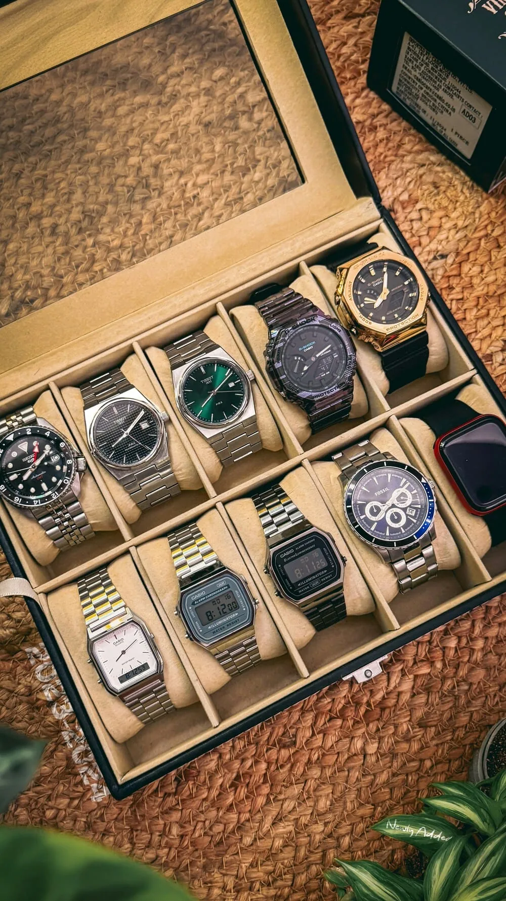

Une collection commence rarement par un plan. On achète une première montre, puis une deuxième parce qu'elle était belle, puis une troisième parce qu'elle était en promotion. Quelques années plus tard, on se retrouve avec cinq plongeuses noires sur bracelet acier et aucune montre à mettre avec un costume. La méthode des rôles sert à éviter ce piège : avant de se demander « quelle montre ? », on se demande « pour quoi faire ? ».

## Penser en rôles plutôt qu'en modèles

L'idée est simple : chaque montre de votre collection doit avoir une fonction dans votre vie. Les rôles les plus courants :

- **La montre du quotidien.** Celle que vous mettez sans réfléchir, au bureau comme le week-end. Polyvalente, lisible, assez robuste, de taille raisonnable.
- **La montre habillée.** Fine, discrète, souvent sur bracelet cuir, qui glisse sous une manche de chemise. Pour les mariages, les entretiens, les dîners.
- **La montre sport ou outil.** Plongeuse, chronographe, GMT, montre de pilote : une montre pensée pour une fonction précise et pour encaisser un peu plus.
- **La montre à tout faire** (*beater*). Celle que l'on porte au jardin, en randonnée, au bricolage, sans aucune inquiétude. Souvent un quartz ou un modèle abordable.

À ces quatre rôles s'ajoutent parfois des rôles plus personnels : la montre de voyage avec un second fuseau, la montre de famille, la pièce coup de cœur que l'on ne porte que le dimanche.

## La collection à trois montres

C'est la formule la plus souvent recommandée pour démarrer, et pour beaucoup de collectionneurs, elle suffit pour la vie :

1. **Une montre de tous les jours** sur bracelet acier, cadran sobre, étanche à au moins 100 m.
2. **Une montre habillée** sur cuir, plus fine, sans fonctions superflues.
3. **Une montre de caractère** : un chronographe, une plongeuse ou une GMT, selon vos goûts et vos activités.

Trois montres bien choisies couvrent la quasi-totalité des situations. Et elles laissent chacune assez de temps au poignet pour que vous les portiez vraiment, ce qui n'est plus le cas au-delà d'une certaine taille de collection.

Une variante populaire consiste à remplacer la montre habillée par une montre à tout faire, pour ceux qui ne portent jamais de costume. La règle reste la même : chaque montre doit couvrir une situation que les autres couvrent mal.

## Éviter les doublons

Le doublon, c'est la montre que vous achetez parce qu'elle vous plaît, mais qui fait exactement le même travail qu'une autre déjà dans votre boîte. Quelques questions à vous poser avant d'acheter :

- **Dans quelle situation vais-je la porter** plutôt qu'une montre que j'ai déjà ?
- **Est-ce un style différent** ou seulement une couleur de cadran différente ?
- **Est-ce le même gabarit**, le même bracelet, la même fonction ?
- **Laquelle vendrais-je** si je ne pouvais en garder qu'une des deux ?

Si vous n'avez pas de réponse claire à la première question, c'est probablement un doublon. Ce n'est pas interdit : certains collectionneurs assument une collection entièrement composée de plongeuses, et c'est une collection cohérente elle aussi. Ce qui compte, c'est que ce soit un choix plutôt qu'un accident.

## Les paliers de budget

Une collection cohérente peut se construire à tous les niveaux de prix. Ce qui change, c'est la façon de répartir le budget.

- **Pour démarrer, quelques centaines d'euros par montre.** Les marques japonaises et suisses d'entrée de gamme, ainsi que les microbrands, offrent des montres automatiques et quartz très honnêtes. C'est l'idéal pour découvrir ce que vous aimez vraiment : taille, style, bracelet.
- **Le palier intermédiaire, de l'ordre de un à quelques milliers d'euros.** Finitions plus soignées, mouvements de manufacture ou certifiés, meilleure tenue de la valeur sur certains modèles.
- **Le haut de gamme.** Ici, chaque achat est un engagement. Mieux vaut avoir déjà compris, avec des montres plus abordables, ce que vous portez réellement.

Une approche efficace : investir davantage dans la montre que vous porterez le plus souvent, et rester raisonnable sur celles qui sortent rarement. Une montre habillée portée quatre fois par an n'a pas besoin du même budget que votre montre quotidienne.

Pensez aussi aux coûts cachés : la révision d'une montre mécanique, l'assurance au-delà d'une certaine valeur, les bracelets de rechange.

## Regardez ce que vous portez vraiment

C'est le conseil le plus utile et le moins suivi. On croit savoir quelles montres on porte, mais la mémoire trompe. La montre achetée récemment semble omniprésente, celle qui dort au fond de la boîte depuis huit mois est oubliée.

Pendant quelques mois, notez chaque jour la montre que vous portez. Les résultats surprennent souvent :

- une montre portée la grande majorité du temps, qui mérite peut-être une version plus aboutie ;
- deux ou trois montres qui ne sortent presque jamais, et dont la vente financerait un achat plus réfléchi ;
- un rôle que vous pensiez important mais qui ne correspond pas à votre vie réelle.

Ces données valent plus que n'importe quelle liste de « montres incontournables ». Elles vous disent quoi acheter, et surtout quoi vendre.

## Vendre pour mieux collectionner

Une collection cohérente n'est pas figée. Vendre une montre que vous ne portez pas n'est pas un échec : c'est la façon la plus saine de faire évoluer votre collection sans la laisser grossir indéfiniment. Beaucoup de collectionneurs appliquent la règle « une qui rentre, une qui sort » une fois atteint le nombre de montres qui leur convient.

## Vos montres dans Arcora

Dans Arcora, le Wrist Check vous permet de noter chaque jour la montre que vous portez, avec des séries qui récompensent la régularité. Au bout de quelques semaines, vous voyez clairement quelles montres vivent au poignet et lesquelles dorment. Et si l'une d'elles n'a plus sa place, vous pouvez la proposer sur le Marché, entre membres et sans commission.

## En résumé

- Pensez en rôles : quotidien, habillée, sport ou outil, montre à tout faire.
- Trois montres bien choisies couvrent presque toutes les situations.
- Avant d'acheter, demandez-vous dans quelle situation la nouvelle montre remplacera les autres.
- Mettez le budget dans la montre que vous portez le plus.
- Notez ce que vous portez vraiment, puis vendez ce qui ne sort jamais.
