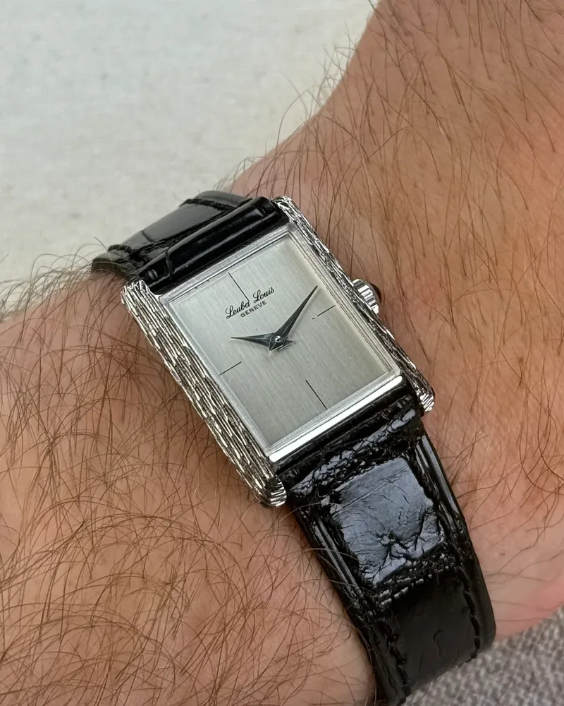

Une belle photo au poignet (le fameux *wrist shot*) ne demande ni appareil coûteux ni studio. Votre téléphone suffit largement, à condition de soigner quatre choses : la lumière, l'angle, la propreté de la montre et quelques réglages simples.

## 1. La lumière : douce et indirecte

C'est le réglage le plus important. Un verre de montre réfléchit tout, et un cadran poli peut devenir une tache blanche en plein soleil.

- **Placez-vous près d'une fenêtre**, sans que le soleil tape directement sur la montre. Une journée nuageuse est idéale : la lumière est douce et uniforme.
- **Évitez le flash** et les éclairages de plafond, qui créent des reflets durs et des couleurs fausses.
- **En extérieur, cherchez l'ombre** ou profitez de la fin de journée, quand la lumière est plus chaude et plus basse.
- **Inclinez légèrement le poignet** jusqu'à ce que le reflet quitte le verre. Quelques degrés suffisent.

## 2. L'angle et l'objectif : éviter la déformation

Les téléphones utilisent par défaut un objectif grand-angle, qui grossit ce qui est proche et rétrécit le reste. Résultat : la montre paraît plus grosse qu'en vrai, et le bracelet se tord.

- **Utilisez le zoom 2× ou 3×** si votre téléphone en a un, en reculant un peu.
- **Sinon, reculez et recadrez** ensuite plutôt que de coller le téléphone à la montre.
- **Tenez le téléphone parallèle au cadran**, ou légèrement au-dessus. Une vue trop de côté écrase les proportions.

C'est aussi une question d'honnêteté : sur la galerie Arcora, d'autres collectionneurs regardent votre photo pour juger de la taille d'une montre sur leur poignet. Une photo sans déformation leur rend vraiment service.

## 3. Une montre propre

Le moindre détail se voit sur une photo nette.

- **Essuyez le verre** avec un chiffon microfibre : traces de doigts et poussières ressortent énormément.
- **Nettoyez le bracelet métal** si besoin, notamment entre les maillons.
- **Réglez l'heure** sur une position qui dégage le logo et les compteurs. Le classique 10 h 10 fonctionne pour cette raison.

## 4. La pose et l'arrière-plan

- **Gardez le poignet détendu**, la main légèrement relâchée. Un poignet crispé fait ressortir les tendons et tourne la montre.
- **Choisissez un fond simple** : une manche, un jean, une table en bois. L'œil doit aller à la montre.
- **Laissez un peu d'espace** autour du poignet pour pouvoir recadrer.

## 5. Les réglages du téléphone

- **Touchez le cadran à l'écran** pour faire la mise au point dessus.
- **Baissez un peu l'exposition** (glissez le doigt vers le bas sur la plupart des téléphones) : il vaut mieux une image légèrement sombre qu'un cadran brûlé.
- **Désactivez le mode portrait** pour les gros plans : le flou artificiel découpe souvent mal les cornes et le bracelet.
- **Prenez plusieurs photos** en variant légèrement l'angle, et gardez la meilleure.

## 6. La retouche : légère

Un léger ajustement de la luminosité, du contraste et du recadrage suffit. Évitez les filtres qui changent les couleurs : un cadran bleu doit rester du même bleu, surtout si la photo aide quelqu'un à choisir.

## Partagez-la sur la galerie

Une fois la photo réussie, ajoutez-la à votre montre dans Arcora et publiez-la sur la galerie au poignet avec votre tour de poignet. Les autres membres peuvent filtrer par taille de poignet et indiquer si la montre leur paraît petite, parfaite ou grande sur vous : c'est le meilleur moyen d'aider quelqu'un qui hésite.

## En résumé

1. Lumière du jour indirecte, sans flash.
2. Zoom 2× ou recul, téléphone parallèle au cadran.
3. Verre et bracelet propres, heure bien choisie.
4. Mise au point sur le cadran, exposition un peu baissée.
5. Retouche légère, couleurs fidèles.
