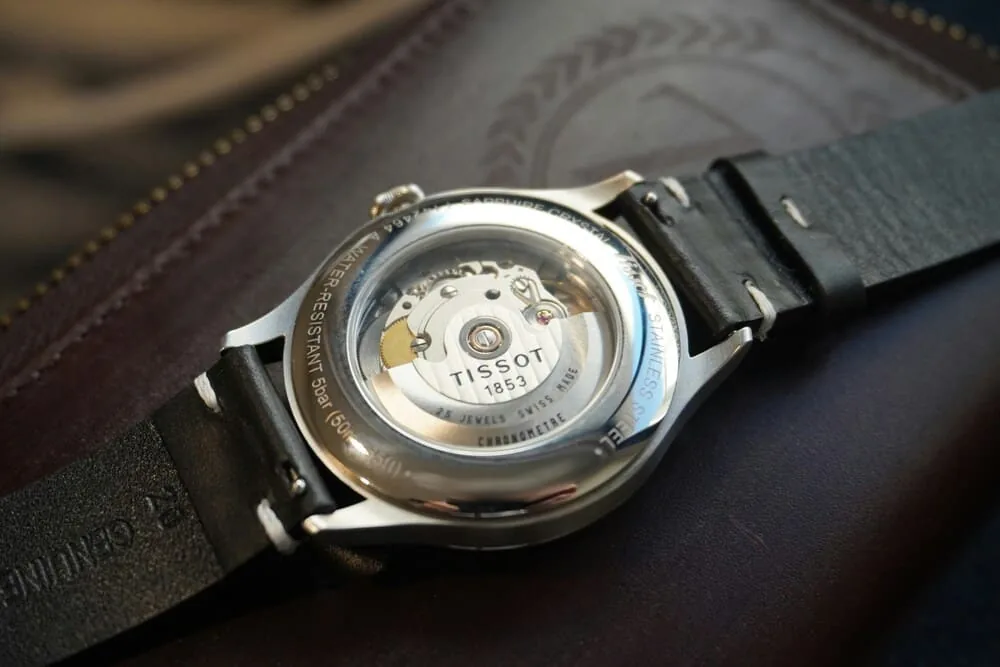
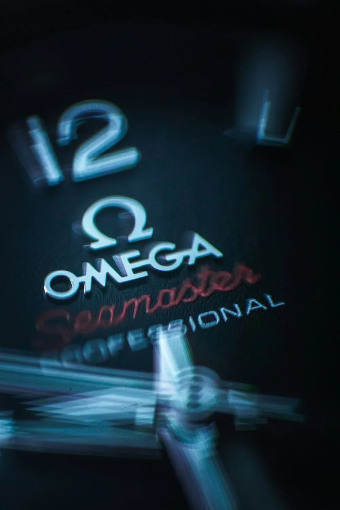

Votre montre automatique a pris quelques secondes d'avance cette semaine. Est-ce normal ? Faut-il s'inquiéter ? Une montre mécanique ne sera jamais aussi précise qu'un quartz, et c'est tout à fait attendu. Mais entre une dérive normale et le signe qu'une révision approche, il y a une différence qu'il est utile de savoir lire.

## Ce que veut dire « secondes par jour »

La précision d'une montre mécanique s'exprime en **secondes par jour** (s/j). Une montre à +5 s/j prend cinq secondes d'avance en vingt-quatre heures ; une montre à −3 s/j en perd trois.

On parle aussi de **marche** : c'est ce même écart quotidien. Ce chiffre n'est jamais parfaitement stable. Il varie selon la façon dont vous portez la montre, sa position la nuit, la température et l'état de charge du ressort. C'est pour cela que les normes parlent de **marche moyenne** mesurée sur plusieurs jours et dans plusieurs conditions.

Pour se donner un ordre de grandeur : une montre qui dérive de 10 s/j accumule environ une minute de décalage par semaine. Pour beaucoup de propriétaires, c'est parfaitement acceptable, à condition de remettre l'heure de temps en temps.

## Les tolérances courantes

Il n'existe pas de précision « normale » unique : tout dépend du calibre et de son niveau de réglage.

- **Les mouvements d'entrée de gamme** sont souvent annoncés par leur fabricant avec des tolérances assez larges. Seiko, par exemple, indique pour ses calibres automatiques 4R une plage de −35 à +45 s/j. En pratique, beaucoup d'exemplaires font bien mieux, mais la marque ne garantit que cette plage.
- **Les mouvements de gamme intermédiaire** sont réglés plus finement, et leurs tolérances annoncées sont plus serrées.
- **Les chronomètres certifiés** répondent à une norme précise, décrite ci-dessous.

Le bon réflexe : chercher la spécification officielle du calibre de votre montre. C'est elle qui dit si votre montre est « dans les clous ».

## Chronomètre, COSC et certifications de marque

Le mot **chronomètre** n'est pas un simple argument commercial. En Suisse, il désigne une montre dont le mouvement a passé les tests du **COSC** (Contrôle officiel suisse des chronomètres). Le mouvement y est testé pendant plusieurs jours, dans différentes positions et à trois températures. Pour un mouvement mécanique de taille courante, la marche moyenne journalière exigée est comprise entre **−4 et +6 s/j**, avec d'autres critères sur la régularité.

Certaines marques vont plus loin avec leurs propres certifications, souvent après emboîtage, c'est-à-dire la montre entière et non le mouvement seul. Rolex annonce par exemple −2/+2 s/j pour ses montres « Superlative Chronometer ». Omega fait certifier une partie de ses montres « Master Chronometer » par l'institut fédéral suisse de métrologie (METAS), avec des tests qui incluent la résistance au magnétisme.

Attention : ces tolérances s'appliquent dans des conditions de test. Au poignet, la marche d'une même montre peut varier un peu, sans que cela signale un défaut.

## Ce qui influence la précision

**La position.** L'organe régulateur, le balancier-spiral, ne se comporte pas exactement de la même façon selon que la montre est à plat, couronne en bas ou couronne en haut. C'est pour cela que la marche n'est pas la même portée ou posée. Astuce connue des collectionneurs : si votre montre avance un peu, essayez de la poser la nuit dans une position où elle retarde, cadran en haut ou couronne en bas par exemple. Testez sur quelques nuits pour trouver la bonne.

**La température.** Le froid et la chaleur modifient légèrement les propriétés du spiral et des huiles. Les alliages modernes limitent fortement cet effet, mais une montre laissée dans une voiture en plein été ou sur un rebord de fenêtre en hiver peut dériver différemment.

**La réserve de marche.** Un ressort bien armé donne une force plus régulière qu'un ressort presque vide. Une montre automatique peu portée, ou une montre à remontage manuel en fin de réserve, peut voir sa marche changer. Une montre portée régulièrement, ou remontée chaque matin, se comporte de façon plus stable.

**Le magnétisme.** C'est la cause la plus fréquente d'une dérive soudaine et importante. Haut-parleurs, fermoirs de sacs aimantés, coques de téléphone, ordinateurs portables, tablettes : les aimants sont partout. Un spiral aimanté colle sur lui-même et la montre se met souvent à avancer fortement, parfois de plusieurs minutes par jour. Bonne nouvelle : un horloger la démagnétise en quelques secondes, souvent pour une somme modique.

**Les chocs.** Une chute ou un choc violent peut dérégler la montre, voire endommager un pivot. Si la marche change brutalement après un choc, faites-la vérifier.

## Comment mesurer la précision de votre montre

**La méthode simple : comparer à une heure de référence.** Pas besoin d'équipement.

1. Ouvrez une source d'heure fiable, synchronisée sur une horloge atomique : un site spécialisé ou l'heure de votre smartphone, qui se règle automatiquement sur le réseau.
2. Mettez votre montre à l'heure exacte, en arrêtant la trotteuse si votre calibre le permet.
3. Chaque jour, à peu près à la même heure, notez l'écart en secondes.
4. Continuez au moins cinq à sept jours, en portant la montre normalement.
5. Divisez l'écart total par le nombre de jours : vous obtenez votre marche moyenne.

Une mesure sur une seule journée ne veut pas dire grand-chose. C'est la moyenne sur une semaine qui reflète votre usage réel.

**La méthode instantanée : le chronocomparateur.** Les horlogers utilisent un appareil, appelé *timegrapher*, qui écoute le tic-tac de la montre et affiche en quelques secondes la marche, l'amplitude du balancier et le défaut de repère (l'écart entre les deux battements). Il existe des applications pour smartphone qui font une mesure du même type avec le micro du téléphone. Elles sont moins précises qu'un appareil d'atelier, sensibles au bruit ambiant, mais elles donnent une bonne indication et permettent de comparer les positions.

## Quand faut-il s'inquiéter ?

Une montre qui reste stable dans sa tolérance, même si celle-ci est large, va bien. Ce qui doit vous alerter, c'est le **changement** :

- la marche se dégrade nettement par rapport à vos mesures précédentes ;
- la montre se met soudain à avancer beaucoup (pensez d'abord au magnétisme) ;
- la réserve de marche diminue en même temps ;
- la marche devient très irrégulière d'un jour à l'autre.

Dans ces cas, une démagnétisation ou un réglage peut suffire. Mais si la montre n'a pas été révisée depuis longtemps, c'est souvent le signe que les huiles vieillissent et qu'une révision complète approche. C'est là que l'historique de vos mesures devient précieux : il permet de voir si la dérive est récente ou progressive.

## Suivre vos mesures dans Arcora

Dans Arcora, vous pouvez noter vos mesures de précision sur la fiche de chaque montre et suivre leur évolution dans le temps, à côté de son historique d'entretien. Une fonction de mesure façon chronocomparateur est en cours d'ajout pour aller plus loin. Le jour où votre montre dérive, vous saurez immédiatement si c'est nouveau.

## En résumé

- La précision se mesure en secondes par jour, en moyenne sur plusieurs jours.
- Un chronomètre COSC doit tenir une marche moyenne de −4 à +6 s/j en test.
- Position, température, réserve de marche et magnétisme influencent la marche.
- Mesurez sur une semaine en comparant à une heure de référence.
- Ce qui compte, c'est l'évolution : une dérive nouvelle mérite une visite chez l'horloger.
