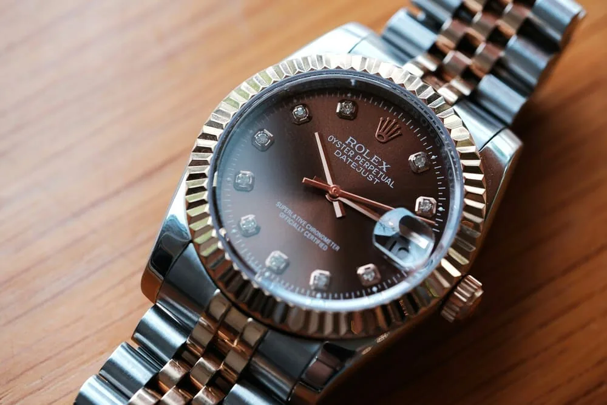
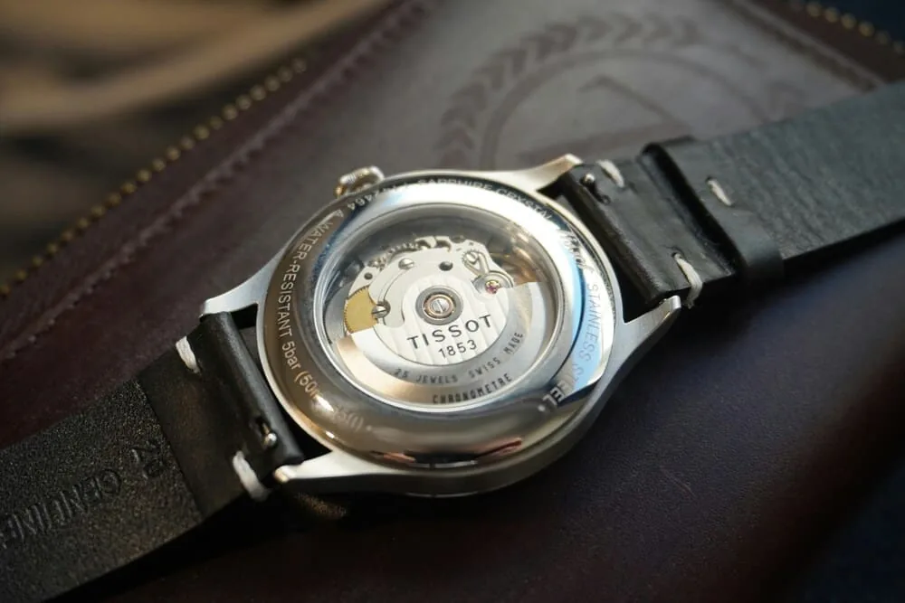

Acheter une montre d'occasion entre particuliers, c'est souvent la meilleure façon de trouver la pièce que l'on cherche à un prix raisonnable. C'est aussi là que circulent les contrefaçons, parfois très réussies. Bonne nouvelle : la plupart des arnaques se repèrent avant même de voir la montre, à condition de prendre le temps de vérifier. Voici une méthode en quatre étapes, de l'annonce jusqu'à la remise en main propre.

## Les signaux d'alerte dans l'annonce

Avant de regarder le cadran, regardez le contexte. Les mêmes indices reviennent très souvent :

- **Un prix nettement sous le marché.** Une montre recherchée ne se vend pas 40 % moins cher que partout ailleurs sans raison. Comparez avec plusieurs annonces du même modèle, au même état et avec le même niveau de papiers.
- **Des photos qui ne sont pas celles du vendeur.** Images trop parfaites, fond blanc de catalogue, ou photos que l'on retrouve ailleurs avec une recherche d'image inversée.
- **Une histoire floue.** « Cadeau jamais porté », « héritage, je n'y connais rien » : ce n'est pas un problème en soi, mais cela ne doit pas remplacer des réponses précises.
- **L'urgence.** « Plusieurs acheteurs sur le coup », « je pars demain » : la pression sert à vous empêcher de vérifier.
- **Un refus de se rencontrer** ou une insistance pour un paiement à distance, par virement instantané ou par un moyen difficile à contester.

Un seul de ces signaux ne prouve rien. Deux ou trois ensemble doivent vous faire ralentir sérieusement.

## Demandez les bonnes photos

Un vendeur honnête n'a aucune difficulté à prendre quelques photos supplémentaires. Demandez :

1. **La montre à côté d'un papier** portant votre prénom et la date du jour. C'est la preuve simple qu'il l'a vraiment entre les mains.
2. **Le cadran de près, bien net**, sans reflet. Les impressions doivent être fines, régulières et parfaitement alignées. Regardez les index, les aiguilles, la loupe de date si le modèle en a une.
3. **Le fond de boîte et les flancs**, pour les gravures et l'état général.
4. **Le fermoir et les maillons**, souvent moins soignés sur les copies.
5. **Une courte vidéo** de la trotteuse et de la mise à l'heure.

Comparez ensuite avec des photos officielles de la marque **pour la même référence**, ou avec des exemplaires vendus par des professionnels reconnus. Les différences portent souvent sur des détails : une typographie légèrement trop grasse, une couleur de cadran qui n'a jamais existé pour cette référence, une date mal centrée dans sa fenêtre, une lunette qui ne correspond pas au modèle.

Gardez en tête une limite importante : les meilleures copies actuelles sont difficiles à distinguer sur photo, même pour un œil exercé. Les photos servent surtout à éliminer les mauvaises annonces, pas à valider définitivement une montre.

## Vérifiez la cohérence : référence, série, papiers

Une montre authentique raconte une histoire cohérente. Une contrefaçon se trahit souvent par une incohérence entre ses éléments.

- **La référence** (le numéro du modèle) doit correspondre exactement à ce que vous voyez : taille, matériau, cadran, lunette, bracelet. Une référence qui n'a jamais existé avec ce cadran est un signal fort.
- **Le numéro de série** doit être cohérent avec l'époque annoncée et identique sur la montre et sur la garantie. Ne demandez pas au vendeur de le publier, mais demandez-le en privé, et ne publiez jamais le vôtre : il peut servir à fabriquer de faux papiers.
- **Les papiers** ne sont pas une preuve absolue. Ils se falsifient aussi, et de vrais papiers peuvent accompagner une fausse montre. Vérifiez que le nom du revendeur, la date et la référence sont plausibles. Une facture d'un revendeur agréé ou d'un service après-vente de la marque est un plus.
- **Le fond de boîte.** Si le modèle a normalement un fond plein et que l'annonce montre un fond transparent, ou l'inverse, posez la question.

## Le calibre, le juge de paix

C'est à l'intérieur que la différence est la plus difficile à cacher. Chaque modèle est équipé d'un calibre précis, documenté par la marque. Une contrefaçon utilise presque toujours un mouvement différent, même quand l'extérieur est très proche.

Quelques repères :

- **Renseignez-vous sur le calibre** de la référence avant de voir la montre : sa forme générale, la masse oscillante, les gravures, les fonctions.
- **Le mouvement de la trotteuse ne suffit pas.** Une trotteuse qui avance par sauts d'une seconde indique un quartz, ce qui est éliminatoire sur une montre censée être mécanique. Mais beaucoup de copies sont automatiques : une trotteuse fluide ne prouve donc rien.
- **Les fonctions doivent toutes marcher comme prévu** : date rapide, aiguille GMT indépendante, chronographe qui démarre, s'arrête et revient à zéro proprement.

Sur une montre à fond plein, seul un horloger peut ouvrir le boîtier et vérifier le calibre. C'est la vérification la plus fiable qui existe pour un particulier.

## Rencontrez-vous chez un horloger

Pour un achat d'un certain montant, proposez de finaliser la vente **chez un horloger indépendant ou un revendeur** qui accepte d'examiner la montre. Comptez une petite somme pour son temps, souvent bien investie. Il pourra ouvrir le fond, identifier le calibre, contrôler l'état général et parfois mesurer la marche.

Un vendeur honnête accepte en général sans difficulté, éventuellement en partageant les frais. Un refus catégorique est en soi une réponse.

Certaines marques proposent aussi un contrôle en service après-vente, avec un délai et un coût variables. C'est plus long, mais c'est l'avis le plus solide.

## Les questions à poser au vendeur

Avant le rendez-vous, posez-les par écrit, et gardez la conversation :

- Depuis quand avez-vous la montre, et où a-t-elle été achetée ?
- A-t-elle été révisée ? Par qui, et avez-vous la facture ?
- Quel est son calibre ?
- Quelles pièces ont été remplacées (cadran, aiguilles, verre, bracelet) ?
- Qu'y a-t-il exactement avec la montre : boîte, garantie, facture, maillons ?
- Acceptez-vous un contrôle chez un horloger avant paiement ?

Les réponses comptent, mais leur précision compte encore plus. Une personne qui connaît sa montre répond vite et sans détour.

## Payer et conclure sans risque

- **Ne payez jamais avant d'avoir vu la montre**, surtout par un moyen irréversible.
- **Préférez une remise en main propre** dans un lieu public ou chez l'horloger.
- **Rédigez un reçu simple** : date, référence, numéro de série, prix, noms et signatures des deux parties.
- **Méfiez-vous des chèques de banque** remis à la dernière minute un soir de week-end : vérifiez-les auprès de la banque émettrice avant de remettre quoi que ce soit.

## Acheter sur Arcora

Sur le Marché d'Arcora, les ventes se font entre membres, sans commission, et vous échangez avec le vendeur par la messagerie de l'app : vous gardez une trace écrite de toutes vos questions et réponses. Chaque annonce est liée à une fiche montre où le vendeur peut renseigner la référence, le calibre et ce qu'il possède en boîte et papiers. Cela facilite les comparaisons, mais ne remplace pas l'œil d'un horloger : pour une pièce importante, gardez le réflexe du rendez-vous en atelier.

## En résumé

- Un prix trop bas, des photos empruntées et de l'urgence doivent vous faire ralentir.
- Demandez des photos datées, nettes, du cadran, du fond et du fermoir.
- Vérifiez la cohérence entre référence, numéro de série, papiers et calibre.
- Les papiers ne prouvent pas tout : seul un horloger peut confirmer le mouvement.
- Pas de paiement à distance avant d'avoir vu la montre.
